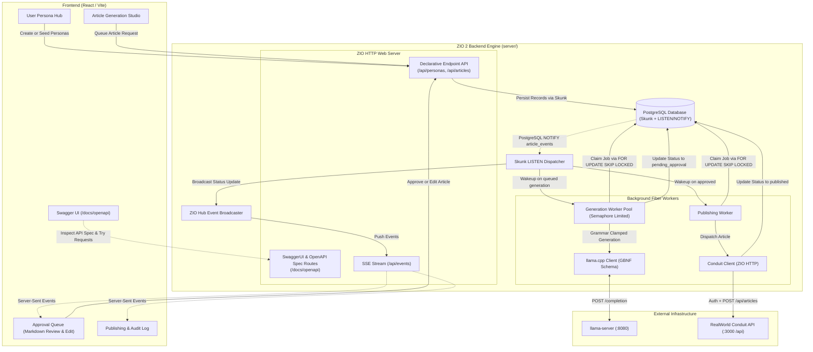

# System Design: AI Article Seeder & Approval Pipeline

## 1. System Overview & Core Philosophy
The **AI Article Seeder** is a high-throughput, human-in-the-loop content generation and publishing engine. It manages "fake" user personas with distinct domain expertise tags, queues and orchestrates deterministic LLM generations via `llama.cpp`, provides an interactive approval dashboard, and publishes approved markdown articles directly to a **RealWorld / Conduit REST API** (`POST /api/articles`).

### Core Technology Stack
* **Base Package:** `com.github.guihigashi.conduit.studio`
* **Backend:** Scala 3.10.x, ZIO 2.x
* **Database Client:** **Skunk** (`skunk-core`) with **ZIO-Cats Interop** (`zio-interop-cats`) for pure, non-blocking, typed PostgreSQL protocol communication (no JDBC).
* **Reactive Notifications:** PostgreSQL `LISTEN / NOTIFY` channels via Skunk's native channel streaming (replaces busy-polling).
* **HTTP, Routing & OpenAPI:** **ZIO HTTP 3.x Endpoint API** with `zio-schema` for declarative type-safe routing, automatic JSON serialization, and built-in **OpenAPI 3.0 / Swagger UI** generation.
* **Real-Time Streaming:** Server-Sent Events (SSE) via ZIO HTTP streaming from a `ZIO.Hub`.
* **LLM Engine:** Local `llama.cpp` (`llama-server`) with JSON Schema / GBNF grammar constraints.
* **Frontend:** React 19, TypeScript, Vite, MUI (Material UI) (bundled as an embedded SPA in production).

---

## 2. End-to-End Architectural Flow



---

## 3. Database Layer: Skunk + ZIO-Cats Interop

Instead of blocking JDBC or macro-heavy Quill, the database tier uses **Skunk**:
* **Non-blocking & Asynchronous:** Speaks the Postgres binary wire protocol natively over non-blocking sockets via `fs2`.
* **Cats-Effect & ZIO Interop:** Uses `zio-interop-cats` to seamlessly bridge `cats.effect.Resource` and `skunk.Session` into `ZIO` environments.
* **Compile-Time & Type-Safe Codecs:** Explicit bi-directional codecs mapping rows directly to Scala 3 `case class` types.
* **Native LISTEN / NOTIFY Channels:** Real-time push events from PostgreSQL sockets without polling.

### 3.1 PostgreSQL DDL Schema & Triggers
```sql
-- 1. Users / Personas
CREATE TABLE personas (
    id UUID PRIMARY KEY DEFAULT gen_random_uuid(),
    username VARCHAR(100) UNIQUE NOT NULL,
    email VARCHAR(255) UNIQUE NOT NULL,
    password_hash VARCHAR(255) NOT NULL, -- Used to register/authenticate against Conduit
    bio TEXT NOT NULL,
    avatar_url TEXT,
    writing_tone VARCHAR(50) NOT NULL,
    created_at TIMESTAMPTZ NOT NULL DEFAULT NOW()
);

-- 2. Domain Expertise Tags
CREATE TABLE tags (
    id UUID PRIMARY KEY DEFAULT gen_random_uuid(),
    name VARCHAR(50) UNIQUE NOT NULL
);

-- 3. Persona Expertise Mappings
CREATE TABLE persona_tags (
    persona_id UUID REFERENCES personas(id) ON DELETE CASCADE,
    tag_id UUID REFERENCES tags(id) ON DELETE CASCADE,
    PRIMARY KEY (persona_id, tag_id)
);

-- 4. Article Status Enum
CREATE TYPE article_status AS ENUM (
    'queued_generation',
    'generating',
    'pending_approval',
    'approved',
    'publishing',
    'published',
    'rejected',
    'failed'
);

-- 5. Articles & Queue Table
CREATE TABLE articles (
    id UUID PRIMARY KEY DEFAULT gen_random_uuid(),
    author_id UUID NOT NULL REFERENCES personas(id) ON DELETE CASCADE,
    topic TEXT NOT NULL,
    selected_tags TEXT[] NOT NULL,
    status article_status NOT NULL DEFAULT 'queued_generation',
    title TEXT,
    description TEXT,
    body_markdown TEXT,
    external_slug TEXT,
    rejection_reason TEXT,
    error_message TEXT,
    created_at TIMESTAMPTZ NOT NULL DEFAULT NOW(),
    updated_at TIMESTAMPTZ NOT NULL DEFAULT NOW(),
    published_at TIMESTAMPTZ
);

-- 6. Trigger to Notify on Status Changes (Replaces Polling)
CREATE OR REPLACE FUNCTION notify_article_event()
RETURNS TRIGGER AS $$
BEGIN
    PERFORM pg_notify('article_events', json_build_object(
        'id', NEW.id,
        'status', NEW.status,
        'author_id', NEW.author_id
    )::text);
    RETURN NEW;
END;
$$ LANGUAGE plpgsql;

CREATE TRIGGER trg_article_status_changed
AFTER INSERT OR UPDATE OF status ON articles
FOR EACH ROW
EXECUTE FUNCTION notify_article_event();
```

---

## 4. Domain Models & State Transitions (Scala 3)

```scala
package com.github.guihigashi.conduit.studio.domain

import java.util.UUID
import java.time.Instant
import zio.schema.{DeriveSchema, Schema}

enum WritingTone derives Schema:
  case TechnicalDeepDive, Conversational, Academic, Opinionated, Tutorial

final case class Persona(
  id: UUID,
  username: String,
  email: String,
  bio: String,
  avatarUrl: Option[String],
  writingTone: WritingTone,
  tags: Set[String]
) derives Schema

enum ArticleStatus derives Schema:
  case QueuedGeneration
  case Generating
  case PendingApproval
  case Approved
  case Publishing
  case Published(externalSlug: String, publishedAt: Instant)
  case Rejected(reason: Option[String])
  case Failed(error: String)

final case class ArticleJob(
  id: UUID,
  authorId: UUID,
  topic: String,
  selectedTags: Set[String],
  status: ArticleStatus,
  title: Option[String],
  description: Option[String],
  bodyMarkdown: Option[String],
  createdAt: Instant,
  updatedAt: Instant
) derives Schema
```

---

## 5. Declarative ZIO HTTP Endpoint API & OpenAPI Specification

Rather than loose, untyped routes, the REST API is defined using ZIO HTTP's declarative **`Endpoint`** API with `zio-schema`. This guarantees:
1. **Type Safety:** Inbound payloads, path parameters, query params, headers, and response bodies are strictly type-checked at compile-time.
2. **Automatic OpenAPI 3.0 Generation:** The exact specification is derived at runtime via `OpenAPIGen.fromEndpoints`.
3. **Interactive Swagger UI:** Served directly by the JVM at `/docs/openapi`.

### 5.1 Endpoint Definitions
```scala
package com.github.guihigashi.conduit.studio.api

import zio.http.*
import zio.http.endpoint.*
import zio.http.codec.*
import com.github.guihigashi.conduit.studio.domain.*
import java.util.UUID

object ApiEndpoints:
  // 1. List all personas
  val listPersonas =
    Endpoint(RoutePattern.GET / "api" / "personas")
      .out[List[Persona]] ?? Doc.p("Retrieve all expert user personas")

  // 2. Create persona
  val createPersona =
    Endpoint(RoutePattern.POST / "api" / "personas")
      .in[CreatePersonaRequest]
      .out[Persona](Status.Created) ?? Doc.p("Create a new fake user persona with domain tags")

  // 3. Queue article generation
  val queueArticle =
    Endpoint(RoutePattern.POST / "api" / "articles")
      .in[QueueArticleRequest]
      .out[ArticleJob](Status.Accepted) ?? Doc.p("Queue a new AI article generation job")

  // 4. List pending approval articles
  val listPendingApproval =
    Endpoint(RoutePattern.GET / "api" / "articles" / "pending-approval")
      .out[List[ArticleJob]] ?? Doc.p("List all articles awaiting human review")

  // 5. Approve & trigger publishing
  val approveArticle =
    Endpoint(RoutePattern.PATCH / "api" / "articles" / PathCodec.uuid("id") / "approve")
      .in[ApproveArticleRequest]
      .out[ArticleJob] ?? Doc.p("Approve article and enqueue for Conduit REST publication")

  val allEndpoints = List(
    listPersonas,
    createPersona,
    queueArticle,
    listPendingApproval,
    approveArticle
  )
```

### 5.2 OpenAPI Documentation & Swagger UI Routing
```scala
package com.github.guihigashi.conduit.studio.api

import zio.http.*
import zio.http.endpoint.openapi.{OpenAPIGen, SwaggerUI}

object DocsRoutes:
  val openAPI = OpenAPIGen.fromEndpoints(
    title = "RealWorld Conduit AI Studio REST API",
    version = "1.0.0",
    ApiEndpoints.allEndpoints
  )

  val swaggerRoutes: Routes[Any, Response] =
    SwaggerUI.routes("docs" / "openapi", openAPI)
```

---

## 6. Structured LLM Generation Strategy (`llama.cpp`)

To eliminate hallucinations and guarantee well-formed articles with exact tags and markdown formatting, `llama-server` is queried with a JSON Schema token constraint:

### 6.1 Article Schema
```json
{
  "type": "object",
  "properties": {
    "title": { "type": "string" },
    "description": { "type": "string", "description": "Concise 1-2 sentence lead" },
    "body": { "type": "string", "description": "Full article formatted in GitHub-Flavored Markdown" },
    "tags": {
      "type": "array",
      "items": { "type": "string" }
    }
  },
  "required": ["title", "description", "body", "tags"]
}
```

### 6.2 Dynamic Persona Prompting
```
System Prompt:
You are @{{username}}, a verified software engineering expert in [{{all_author_tags}}].
Your writing style is {{writing_tone}}.

Task:
Write a comprehensive, publication-ready article on "{{topic}}".
Emphasize and incorporate the following focus areas: [{{selected_tags}}].
Ensure the markdown body contains rich formatting, headers, and code snippets where appropriate.
```

---

## 7. RealWorld / Conduit REST Publishing Integration

When an article transitions from `PendingApproval` to `Approved`:

1. **Authentication:**
   * The publisher fiber logs in or registers the persona against the Conduit instance:
     `POST /api/users/login` with `{"user": {"email": "...", "password": "..."}}`
   * Obtains the JWT Bearer token: `Authorization: Token <jwt>`.
2. **Article Publication:**
   * Sends `POST /api/articles`:
     ```json
     {
       "article": {
         "title": "Mastering ZIO 2 Fibers",
         "description": "A deep dive into lightweight concurrency on the JVM.",
         "body": "# Introduction\n\nFibers provide...",
         "tagList": ["scala", "zio", "concurrency"]
       }
     }
     ```
3. **Response Handling:**
   * On HTTP 201 Created: Extracts `article.slug` and marks status as `Published(slug)`.
   * On error (422 Unprocessable, 500, etc.): Records failure message and marks status as `Failed(error)` with retry option.

---

## 8. Event-Driven Concurrency: Pure LISTEN / NOTIFY (Zero Polling)

Instead of continuous database polling loops, the system operates completely on push notifications powered by PostgreSQL's `LISTEN / NOTIFY` via Skunk socket channels.

### 8.1 How Workers Listen & Claim Jobs
1. **Suspension on Skunk Channel:**
   * A dedicated Skunk session listens to `article_events`:
     ```scala
     session.channel(id"article_events")
       .listen(maxQueued = 1024) // fs2.Stream[Task, Notification[String]]
     ```
   * While waiting for events, the fiber is suspended. **CPU usage is 0% and no database queries are executed.**

2. **Atomic Job Claiming (`FOR UPDATE SKIP LOCKED`):**
   * When an `article_events` notification arrives with `status = 'queued_generation'`, the generation worker wakes up and claims the next available job:
     ```sql
     UPDATE articles
     SET status = 'generating', updated_at = NOW()
     WHERE id = (
         SELECT id FROM articles
         WHERE status = 'queued_generation'
         ORDER BY created_at ASC
         FOR UPDATE SKIP LOCKED
         LIMIT 1
     )
     RETURNING *;
     ```
   * Multiple fibers can safely race to claim jobs without blocking or deadlocking.

3. **GPU Protection via `ZIO.Semaphore`:**
   * A `Semaphore(permits = maxConcurrentGpuStreams)` ensures that parallel generations never exceed the hardware context window of `llama.cpp`.

4. **One-Time Startup Sweep:**
   * The only non-notification query is executed once upon server boot to drain any jobs that were enqueued or left in-flight if the server restarted while jobs were pending.

---

## 9. Real-Time UI Streaming: Server-Sent Events (SSE)

1. **Backend Event Fan-Out:**
   * Postgres notifications from Skunk feed directly into a centralized `ZIO.Hub[ArticleNotification]`.
2. **ZIO HTTP SSE Endpoint:**
   * An endpoint `GET /api/events` streams real-time updates directly to the browser.
3. **Instant UI Updates:**
   * When `llama.cpp` finishes generating and saves an article as `pending_approval`, the notification reaches the UI within milliseconds. The **Approval Board** renders the new card immediately without manual page refreshes or HTTP polling.

---

## 10. Frontend Dashboard Blueprint (React 19 + Vite)

1. **Persona Manager:**
   * Grid of persona cards with avatars, tone badges, and tag chips.
   * "Add Persona" modal (Manual entry or "Generate with AI" button).
2. **Generation Studio:**
   * Step 1: Select author persona.
   * Step 2: Available tags populate automatically; select a subset of tags.
   * Step 3: Enter topic or prompt hints.
   * Step 4: Click *"Enqueue Article"*.
3. **Approval Board:**
   * Real-time list of generated articles awaiting human sign-off (driven by SSE).
   * Split-screen preview: Left side editable markdown, right side live rendered GitHub-Flavored Markdown.
   * Action buttons: `Approve & Publish`, `Reject`, `Regenerate`.
4. **Publishing Monitor:**
   * Live feed of published articles with direct links to the live Conduit instance.
5. **Interactive API Docs:**
   * Built-in link to Swagger UI (`/docs/openapi`).
