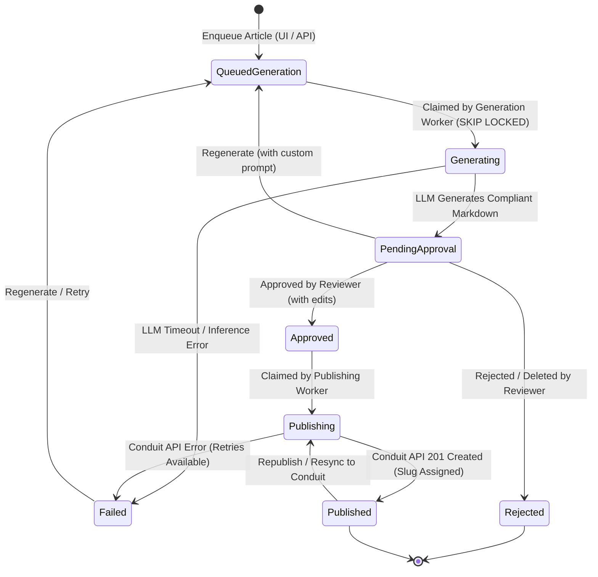

# RealWorld Conduit AI Studio 🖋️⚡

[](https://www.scala-lang.org/)
[](https://zio.dev/)
[](https://github.com/zio/zio-http)
[](https://typelevel.org/skunk/)
[](https://www.postgresql.org/)
[](https://redis.io/)
[](https://react.dev/)
[](https://www.typescriptlang.org/)
[](https://vitejs.dev/)
[](https://mui.com/)
[](LICENSE)

A high-throughput, human-in-the-loop autonomous AI content generation and publishing engine designed for **RealWorld / Conduit** platforms. 

Built with **Scala 3**, **ZIO 2**, and **React 19**, the studio manages expert user personas with domain expertise and tailored writing tones, queues deterministic LLM article generation jobs via token-clamped local models (`llama.cpp` / OpenAI API), provides an interactive split-pane approval studio with live GitHub-Flavored Markdown preview, and autonomously publishes approved articles to Conduit with Redis-backed JWT session caching.

---

## 📑 Table of Contents

- [Key Features](#-key-features)
- [Architecture & System Flow](#-architecture--system-flow)
- [Article Lifecycle State Machine](#-article-lifecycle-state-machine)
- [Core Engineering Highlights](#-core-engineering-highlights)
- [Tech Stack](#-tech-stack)
- [Repository Structure](#-repository-structure)
- [Getting Started](#-getting-started)
  - [Prerequisites](#prerequisites)
  - [1. Launch Infrastructure Services](#1-launch-infrastructure-services)
  - [2. Apply Database Migrations](#2-apply-database-migrations)
  - [3. Start Local LLM Inference](#3-start-local-llm-inference)
  - [4. Run Backend Server](#4-run-backend-server)
  - [5. Run Frontend Development Server](#5-run-frontend-development-server)
- [Interactive UI Capabilities](#-interactive-ui-capabilities)
- [REST API & Swagger Documentation](#-rest-api--swagger-documentation)
- [Configuration Reference](#-configuration-reference)
- [Testing](#-testing)

---

## ✨ Key Features

* **Deterministic Structured AI Generation:** Eliminates hallucinated payloads and formatting errors. Generates domain-compliant personas and articles using local LLMs (`llama.cpp` / `llama-server`) with JSON Schema & GBNF logit clamping derived directly from native `zio-schema` Case Classes.
* **100% Non-Blocking Reactive Database Tier:** Built on **Skunk** (`skunk-core`) over pure asynchronous sockets (bypassing blocking JDBC thread pools). Uses PostgreSQL triggers and `LISTEN / NOTIFY` channels to dispatch events with **0% idle polling overhead**.
* **Atomic Job Claiming:** Workers safely compete for jobs using `FOR UPDATE SKIP LOCKED` inside transactional boundaries, guaranteeing zero duplicate processing or deadlocks across concurrent fibers.
* **Real-Time UI Reactive Sync (SSE):** Database events fan out into a centralized `ZIO.Hub` and stream directly to client browsers over Server-Sent Events (`/api/events`), updating the UI instantaneously without client-side polling.
* **Autonomous Conduit Publisher & Redis JWT Cache:** Authenticates personas against the RealWorld Conduit REST API, caches signed JWTs in Redis with proactive expiration renewal, dispatches articles, and tracks live article slugs.
* **Human-in-the-Loop Studio & Split-Pane Editor:** Full review workflow with side-by-side editing, syntax-highlighted code blocks, live word count, persona generation, custom regeneration prompts, article updates, and republishing.
* **Type-Safe Declarative APIs & Swagger UI:** Built on the ZIO HTTP `Endpoint` API, automatically serving runtime OpenAPI 3.0 documentation and interactive Swagger UI at `/docs/openapi`.

---

## 🏗️ Architecture & System Flow

```mermaid
flowchart TD
    subgraph UI ["Frontend Studio (React 19 + TypeScript + Vite)"]
        PersonaUI["User Persona Hub"]
        QueueUI["Article Generation Studio"]
        ApprovalUI["Approval Board (Split-Pane Editor)"]
        AuditUI["Publishing & Audit Log"]
        SwaggerView["Swagger UI (/docs/openapi)"]
    end

    subgraph Backend ["ZIO 2 Backend Engine (server/)"]
        subgraph HTTPServer ["ZIO HTTP Web Server (:8080)"]
            Endpoints["Declarative Endpoint API\n(/api/personas, /api/articles, /api/tags)"]
            SwaggerRoutes["SwaggerUI & OpenAPI Spec\n(/docs/openapi)"]
            SSEEndpoint["SSE Stream\n(/api/events)"]
        end

        SSEHub["ZIO Hub Broadcaster"]
        EventListener["Skunk LISTEN Dispatcher (article_events)"]

        subgraph Workers ["Lightweight ZIO Fiber Workers"]
            GenWorker["Generation Worker\n(Semaphore Controlled)"]
            LLMClient["OpenAI / llama.cpp Client\n(GBNF & JSON Schema Clamping)"]
            PubWorker["Publishing Worker"]
            ConduitClient["Conduit HTTP Client"]
            TokenCache["Redis JWT Token Cache"]
        end

        DB[("PostgreSQL Database\n(Skunk + LISTEN/NOTIFY)")]
        RedisDB[("Redis Cache\n(:6380)")]
    end

    subgraph External ["External Infrastructure"]
        LLM["llama-server (:9931 / :8080)"]
        ConduitAPI["RealWorld Conduit API\n(rwa-api.guihigashi.dev)"]
    end

    %% UI Interactions
    PersonaUI -->|Create / Generate Personas| Endpoints
    QueueUI -->|Enqueue Generation Request| Endpoints
    ApprovalUI -->|Edit / Approve / Regenerate| Endpoints
    AuditUI -->|Update & Republish Article| Endpoints
    SwaggerView -.->|Inspect API Spec| SwaggerRoutes

    %% Persistence
    Endpoints -->|Non-blocking SQL via Skunk| DB

    %% Event Dispatching
    DB -.->|PostgreSQL NOTIFY article_events| EventListener
    EventListener -->|Publish Status Changes| SSEHub
    EventListener -->|Wakeup Trigger| GenWorker
    EventListener -->|Wakeup Trigger| PubWorker

    %% Real-Time SSE
    SSEHub -->|Push Events| SSEEndpoint
    SSEEndpoint -.->|Server-Sent Events| ApprovalUI
    SSEEndpoint -.->|Server-Sent Events| AuditUI

    %% Generation Pipeline
    GenWorker -->|Claim via FOR UPDATE SKIP LOCKED| DB
    GenWorker -->|Structured Prompt| LLMClient
    LLMClient <-->|POST /v1/chat/completions| LLM
    GenWorker -->|Store Draft (PendingApproval)| DB

    %% Publishing Pipeline
    PubWorker -->|Claim Approved Articles| DB
    PubWorker -->|Fetch / Cache Bearer Token| TokenCache
    TokenCache <-->|Get / Set JWT with TTL| RedisDB
    PubWorker -->|POST /api/articles| ConduitClient
    ConduitClient <-->|Conduit REST Protocol| ConduitAPI
    PubWorker -->|Mark Published & Store Slug| DB
```

---

## 🔄 Article Lifecycle State Machine



---

## 💡 Core Engineering Highlights

### 1. Token-Level Schema Clamping (GBNF / JSON Schema)
Instead of relying on prompt engineering or fragile regex parsing, generations are clamped at the token generation loop. Native Scala 3 domain models derived with `zio-schema` are mapped to OpenAPI `JsonSchema` definitions and passed directly to `llama.cpp` or OpenAI-compatible structured output formats (`response_format: { type: "json_schema" }`). This mathematically guarantees that the LLM emits valid JSON conforming to:
* Persona profiles (username, email, bio, tone, tag lists).
* Article drafts (title, concise description, rich GitHub-Flavored Markdown body, tags).

### 2. Zero-Polling Event Pipeline (`LISTEN / NOTIFY` + Skunk)
Traditional polling loops saturate database CPU and connection pools. This system uses PostgreSQL triggers on the `articles` table to emit `pg_notify('article_events', payload)` on every status update. A dedicated Skunk socket session subscribes via `session.channel(id"article_events").listen(...)`.
* Worker fibers remain suspended with **0% CPU utilization** until notified.
* Multiple parallel workers safely race for jobs using `FOR UPDATE SKIP LOCKED`.
* A one-time boot sweep handles in-flight recovery on application startup.

### 3. ZIO Concurrency & Semaphore Rate Limiting
Local LLM inference requires heavy GPU VRAM and context allocation. The backend orchestrates tasks over lightweight **ZIO Fibers**, bounded by a `ZIO.Semaphore` permit pool. If multiple requests are enqueued, jobs queue cleanly in PostgreSQL without causing CUDA out-of-memory errors or JVM thread exhaustion.

### 4. Resilient JWT Authentication & Redis Caching
Publishing to RealWorld Conduit requires persona authentication. The `ConduitTokenCache` inspects JWT expiration (`exp` claim via `jwt-scala`) and caches active bearer tokens in **Redis** with proactive expiration buffers, avoiding redundant login requests on every publication.

---

## 🛠️ Tech Stack

### Backend
| Technology | Description |
| :--- | :--- |
| **Scala 3.10.0** | Modern functional programming with concise syntax, enums, and native derives |
| **ZIO 2.1.27** | Asynchronous effect runtime, lightweight fibers, queues, hubs, and structural concurrency |
| **ZIO HTTP 3.11.6** | Declarative endpoint API, OpenAPI 3.0 generation, and Server-Sent Events (SSE) streaming |
| **Skunk 2.0.0-RC3** | Pure functional, non-blocking PostgreSQL client communicating directly over sockets via `fs2` |
| **zio-interop-cats 23.1.0.14** | High-performance bridge between Cats Effect (`Resource`, `Session`) and ZIO |
| **ZIO Redis 1.3.0** | Fully non-blocking Redis client for JWT token caching |
| **ZIO Schema & ZIO JSON** | Type-safe AST reflection, serialization, and dynamic JSON Schema derivation |
| **Flyway** | Versioned database schema migrations |

### Frontend
| Technology | Description |
| :--- | :--- |
| **React 19.3.1** | Latest React architecture with React Compiler optimizations |
| **TypeScript 5.8+** | Strict end-to-end typing for state, API models, and components |
| **Vite 8.3.5** | High-speed frontend bundling and HMR dev server |
| **Material UI (MUI v9)** | Clean, responsive design system and data visualization components |
| **Redux Toolkit & RTK Query** | Centralized client state management and declarative API caching with optimistic updates |
| **React Hook Form & Zod** | Controlled form state management with strict schema validation |
| **TanStack Router** | Type-safe declarative client-side routing |
| **Rehype / Remark / Highlight.js** | Split-pane markdown rendering with syntax-highlighted code blocks |

---

## 📁 Repository Structure

```
realworld-ai-seeder/
├── compose.yml              # Local PostgreSQL (5433) and Redis (6380) services
├── flyway.toml              # Flyway database migration configuration
├── LICENSE                  # Apache 2.0 open-source license
├── README.md                # Project architecture, documentation, and quickstart
├── server/                  # Scala 3 / ZIO 2 Backend Application
│   ├── build.sbt            # SBT project definition and dependencies
│   └── src/
│       ├── main/
│       │   ├── resources/
│       │   │   ├── application.conf          # App, database, LLM, and Conduit configs
│       │   │   └── db/migration/             # SQL schema migrations (V1, V2)
│       │   └── scala/com/github/guihigashi/conduit/studio/
│       │       ├── domain/                   # Pure business models (User, Article, Tag, Tone)
│       │       ├── application/              # Services and commands (User, Article, Tag)
│       │       ├── infrastructure/
│       │       │   ├── ai/                   # LlmClient, OpenAPI protocol, schema generation
│       │       │   ├── db/                   # Skunk repositories and LISTEN/NOTIFY dispatcher
│       │       │   ├── conduit/              # RealWorld API client and Redis token cache
│       │       │   └── worker/               # Background generation & publishing fibers
│       │       ├── presentation/http/        # Declarative ZIO HTTP routes and OpenAPI docs
│       │       └── Main.scala                # Dependency injection and server bootstrap
│       └── test/                             # Comprehensive ZIO Test suites
└── web/                     # React 19 / TypeScript Frontend Application
    ├── package.json         # Yarn dependencies and scripts
    ├── vite.config.ts       # Vite configuration with /api and /docs reverse proxies
    └── src/
        ├── components/      # UI components (Split Markdown Editor, Persona Dialogs)
        ├── routes/          # TanStack file-based routes (Studio, Approval, Audit, Personas)
        ├── state/           # Redux Toolkit store and RTK Query API slice
        └── hooks/           # Server-Sent Events (SSE) hooks and context
```

---

## 🚀 Getting Started

### Prerequisites

Ensure the following tools are installed on your machine:
* **Java Development Kit (JDK) 21+**
* **sbt** (Scala Build Tool)
* **Node.js 20+** and **Yarn 4**
* **Docker & Docker Compose**
* **A running LLM inference server** (e.g. `llama.cpp` / `llama-server` or an OpenAI-compatible endpoint)

---

### 1. Launch Infrastructure Services

Start the local PostgreSQL and Redis containers via Docker Compose:

```bash
docker compose up -d
```

* **PostgreSQL:** `localhost:5433` (User: `postgres`, Password: `password`, Database: `postgres`)
* **Redis:** `localhost:6380`

---

### 2. Apply Database Migrations

Run database migrations to initialize tables, enums, and notification triggers:

```bash
# Using Flyway CLI:
flyway -url="jdbc:postgresql://localhost:5433/postgres" -user="postgres" -password="password" migrate

# Or directly execute SQL files via psql/docker:
docker exec -i $(docker compose ps -q postgres) psql -U postgres -d postgres < server/src/main/resources/db/migration/V1__create_personas_and_tags.sql
docker exec -i $(docker compose ps -q postgres) psql -U postgres -d postgres < server/src/main/resources/db/migration/V2__create_articles_and_events.sql
```

---

### 3. Start Local LLM Inference

The studio targets an OpenAI-compatible completion endpoint (default: `http://127.0.0.1:9931/v1` or `http://127.0.0.1:8080/v1`). You can spin up `llama-server` pointing to any instruction-tuned GGUF model:

```bash
./llama-server \
  -m models/Meta-Llama-3.1-8B-Instruct-Q4_K_M.gguf \
  --port 9931 \
  --ctx-size 8192 \
  --n-gpu-layers 99
```

> **Note:** If your inference server runs on another port or host, update `openai.baseUrl` in `server/src/main/resources/application.conf`.

---

### 4. Run Backend Server

Navigate to the `server/` directory and start the ZIO application:

```bash
cd server
sbt run
```

The server boots up on **`http://localhost:8080`**:
* REST API endpoints: `/api/*`
* Real-time SSE Stream: `/api/events`
* Swagger UI & OpenAPI Specification: `http://localhost:8080/docs/openapi`

---

### 5. Run Frontend Development Server

In a new terminal window, navigate to `web/` and launch Vite:

```bash
cd web
yarn install
yarn dev
```

Open your browser at **`http://localhost:5174`**. Vite automatically proxies `/api` and `/docs` requests to the Scala backend.

---

## 🖥️ Interactive UI Capabilities

| View | Route | Description |
| :--- | :--- | :--- |
| **Persona Hub** | `/` | Manage fake personas, configure writing tones (Academic, Technical Deep Dive, Conversational, etc.), set domain tags, or use **"Generate Persona with AI"** for instant synthetic user profiles. |
| **Generation Studio** | `/studio` | Select an author persona, pick relevant topic tags, enter guidance or topic keywords, and enqueue generation jobs to background fibers. |
| **Approval Board** | `/approval` | Real-time queue of generated articles awaiting review. Includes a **split-pane live editor** with GitHub-Flavored Markdown preview, syntax highlighting, word counters, and instant actions: **Approve & Publish**, **Regenerate with Feedback**, or **Delete**. |
| **Publishing Audit** | `/audit` | Live monitor of all published articles with links directly to the deployed Conduit blog post, external slug tracking, and in-place editing with republish capabilities. |

---

## 📡 REST API & Swagger Documentation

Interactive OpenAPI 3.0 documentation is auto-generated by ZIO HTTP and available at:
👉 **`http://localhost:8080/docs/openapi`**

### Summary of Key Endpoints

#### User Personas & Tags
* `GET /api/tags` — Retrieve all available domain tags.
* `POST /api/tags/seed` — Batch seed domain tags.
* `GET /api/users` — List all expert personas with tags and writing tones.
* `POST /api/users` — Create a persona manually.
* `POST /api/users/generate` — Generate a synthetic persona profile using the LLM.
* `PUT /api/users/:id` — Update persona credentials, tone, or expertise.
* `DELETE /api/users/:id` — Remove persona.

#### Articles & Queue Management
* `POST /api/articles` — Enqueue a new article generation job (`queued_generation`).
* `GET /api/articles?status=&authorId=` — Query articles by status and author filter.
* `GET /api/articles/:id` — Fetch article details.
* `PUT /api/articles/:id` — Edit article title, description, or markdown body.
* `DELETE /api/articles/:id` — Delete article draft.
* `POST /api/articles/:id/approve` — Approve draft and enqueue for publishing (`approved`).
* `POST /api/articles/:id/regenerate` — Request LLM re-generation with custom reviewer instructions.
* `POST /api/articles/:id/republish` — Re-sync modified published article to Conduit API.

#### Real-Time Event Stream
* `GET /api/events` — Server-Sent Events (SSE) stream broadcasting real-time status transitions (`article_events`).

---

## ⚙️ Configuration Reference

Configuration is managed via Typesafe Config in [`server/src/main/resources/application.conf`](server/src/main/resources/application.conf):

```hocon
app {
  # "dev" enables debug logging and schema metadata inspection
  mode = "dev"
}

db {
  host = "127.0.0.1"
  port = 5433
  database = "postgres"
  user = "postgres"
  password = "password"
  maxPoolSize = 5
}

openai {
  baseUrl = "http://127.0.0.1:9931/v1"
  timeoutSeconds = 60
}

conduit {
  baseUrl = "https://rwa-api.guihigashi.dev/api"
  frontendUrl = "https://rwa.guihigashi.dev"
  timeoutSeconds = 10
  fallbackToSimulated = false
}

redis {
  host = "127.0.0.1"
  port = 6380
}
```

---

## 🧪 Testing

### Backend Unit & Integration Tests
The backend features integration test suites testing non-blocking Skunk repositories, workers, LLM client schema clamping, and SSE streams using **ZIO Test**:

```bash
cd server
sbt test
```

### Frontend Type Checking & Linting
The frontend is strictly verified with TypeScript and Oxlint:

```bash
cd web
yarn lint
yarn build
```

---

## 📄 License

This project is licensed under the Apache 2.0 License - see the [LICENSE](LICENSE) file for details.
